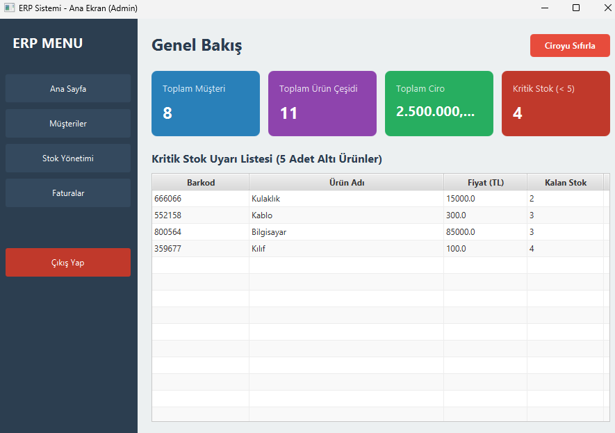
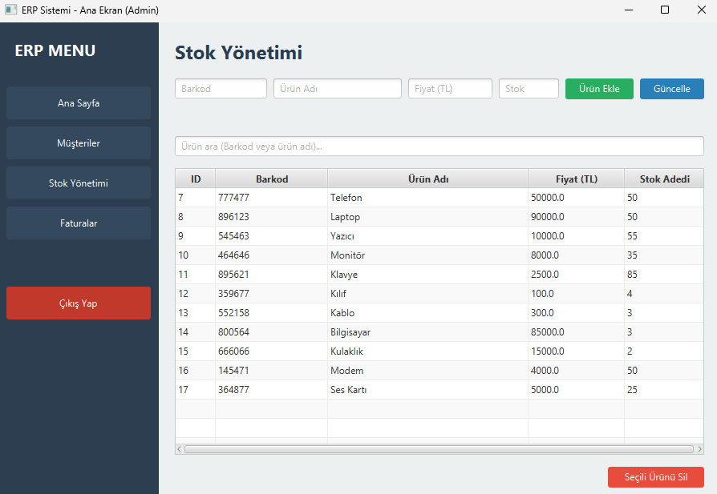
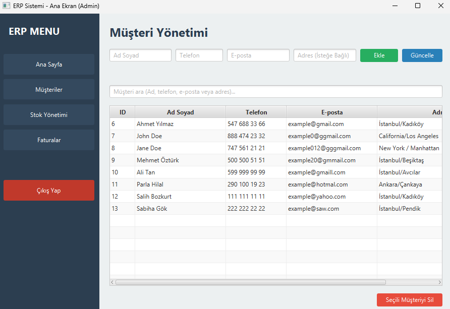
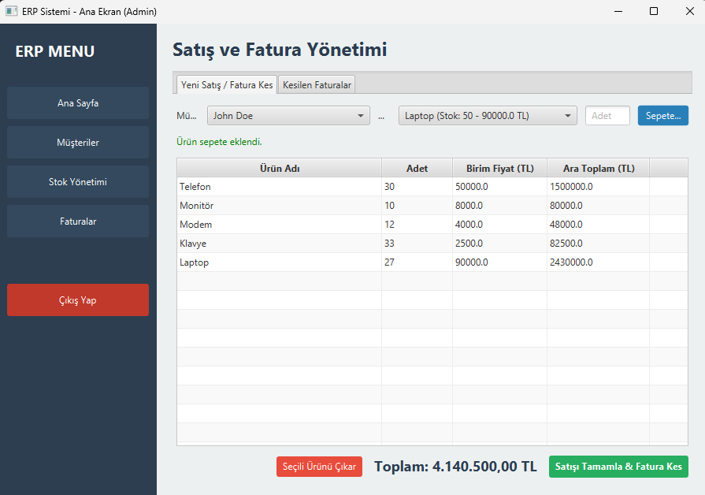

# JavaFX-Based Desktop ERP Management System

This project is a modular desktop Enterprise Resource Planning (ERP) application developed with **Java**, **JavaFX**, and **MySQL**. It streamlines core business operations—including customer management, inventory tracking, transactional sales processing, and invoice generation—through a unified dashboard interface.

## Project Images

<p align="center">
  
  
</p>
<p align="center">
  
  
</p>

## How It Works

1. The user authenticates through the login screen (`admin` / `123`) to access the main dashboard.
2. A `BorderPane`-based navigation menu dynamically loads individual FXML modules (`Home`, `Customers`, `Inventory`, `Invoices`) into the center view.
3. All CRUD operations and live search filters interact with the local MySQL database (`erp_db`) via JDBC.
4. When a sale is completed, an atomic database transaction creates records in `sales`, `sale_items`, and `invoices` while automatically deducting sold quantities from `products`.
5. Deleted products are handled via **Soft Delete** (`is_active = FALSE`) to preserve referential integrity (`ON DELETE RESTRICT`) on historical invoices.

```
JavaFX UI (FXML) → Controllers (MVC) → JDBC Connection → MySQL Database (erp_db)
```

## System Modules

| Module | Purpose |
| :--- | :--- |
| **Overview Dashboard** | Real-time KPI cards (customers, active products, total revenue, critical stock `< 5`) and revenue reset |
| **Customer Management** | Full CRUD operations with table row selection and live `FilteredList` / `SortedList` search |
| **Inventory Management** | Product CRUD, barcode/name live filtering, and Soft Delete (`is_active`) support |
| **Sales & Invoicing** | Shopping cart with stock validation, ACID transaction commit/rollback, auto invoice numbering (`INV-YYYY-XXXX`), and invoice detail modal |

## Database Tables

| Table | Purpose |
| :--- | :--- |
| `users` | Administrative login credentials |
| `customers` | Customer contact and address information |
| `products` | Inventory records with `stock_quantity` and `is_active` soft-delete flag |
| `sales` | Master sales transactions linked to customers |
| `sale_items` | Itemized product quantities and unit prices per sale |
| `invoices` | Sequential invoice numbers mapped to sales records |

## Technologies Used

- **Java 17+** — Core application logic and OOP models
- **JavaFX 21** — Desktop user interface (FXML & CSS)
- **MySQL 8+** — Relational database management (`mysql-connector-j` / JDBC)
- **Apache Maven** — Dependency management and build automation

## Installation and Usage

### 1. Clone the Repository
```bash
git clone [https://github.com/leventgcode/ERP_System.git](https://github.com/leventgcode/ERP_System.git)
cd ERP_System
```

### 2. Set Up the MySQL Database
Run `database.sql` in MySQL Workbench or CLI to create the `erp_db` schema and tables. Ensure the soft-delete column is present on the `products` table:
```sql
USE erp_db;
ALTER TABLE products ADD COLUMN is_active BOOLEAN NOT NULL DEFAULT TRUE;
```

### 3. Configure the Database Connection
Open `DatabaseConnection.java` and enter your local MySQL credentials:
```java
private static final String URL = "jdbc:mysql://localhost:3306/erp_db";
private static final String USER = "root";
private static final String PASSWORD = "your_password";
```

### 4. Run the Application
Start the project with Maven (or run `HelloApplication.java` directly in IntelliJ IDEA):
```bash
mvn clean javafx:run
```

### 5. Default Login Credentials
```text
Username: admin
Password: 123
```

## Project Files

```text
ERP_System/
├── database.sql                                 # MySQL database schema
├── pom.xml                                      # Maven dependencies and JavaFX config
├── screenshots/                                 # Application preview images
└── src/main/
    ├── java/com/example/erp_system/
    │   ├── HelloApplication.java                # Application entry point
    │   ├── HelloController.java                 # Login screen controller
    │   ├── DashboardController.java             # Main layout & sidebar navigation
    │   ├── HomeController.java                  # Live KPIs, critical stock & revenue reset
    │   ├── CustomersController.java             # Customer CRUD & live search
    │   ├── ProductsController.java              # Inventory CRUD, soft delete & live search
    │   ├── InvoicesController.java              # Cart, transactional sales & invoice modal
    │   ├── DatabaseConnection.java              # MySQL JDBC connection handler
    │   ├── Customer.java                        # Customer data model
    │   ├── Product.java                         # Product data model
    │   ├── CartItem.java                        # Shopping cart item model
    │   └── Invoice.java                         # Invoice data model
    └── resources/com/example/erp_system/
        ├── hello-view.fxml                      # Login view
        ├── dashboard.fxml                       # Main dashboard layout
        ├── home.fxml                            # Overview statistics view
        ├── customers.fxml                       # Customers module view
        ├── products.fxml                        # Inventory module view
        └── invoices.fxml                        # Sales & invoices module view
```
